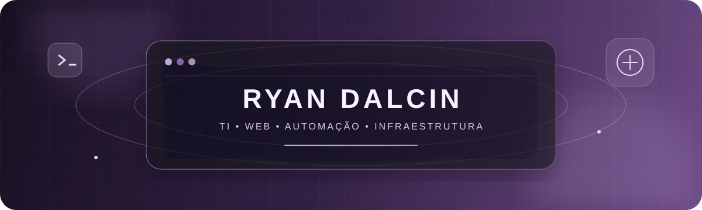
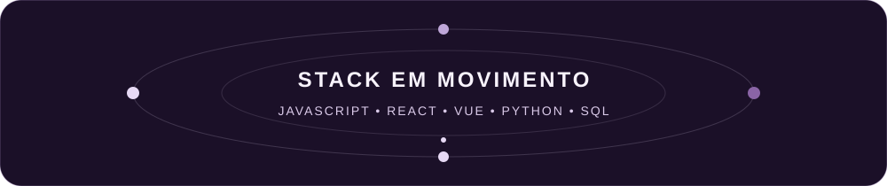

<!-- ✨ RYAN DALCIN | PERFIL ROXO ✨ -->

 

  

  

---

## 🪐 Sobre mim

Olá! Eu sou o **Ryan Dalcin**. Sou estagiário de TI e gosto de aprender construindo coisas que resolvem problemas reais.

Na **Secretaria Estadual da Agricultura, Pecuária e Irrigação (SEAPI)**, trabalho com:

> **automação + desenvolvimento + redes + infraestrutura + criatividade**

No dia a dia, faço manutenção de códigos, automações, sites e sistemas. Também ajudo com redes e infraestrutura. Gosto de deixar as coisas organizadas, funcionando bem e fáceis de usar.

 

### 🎯 O que estou buscando

## 🧪 Tecnologias que uso

  

  

## 🚀 Projetos em destaque

<table>
<tr>
<td width="50%" valign="top">

### ⚙️ GesTI

Sistema voltado à organização e gestão de TI.

</td>
<td width="50%" valign="top">

### 🧩 API Hunters

Projeto para trabalhar com APIs e integrações.

</td>
</tr>
<tr>
<td width="50%" valign="top">

### 📝 PlusNote

Aplicação simples para organizar anotações.

</td>
<td width="50%" valign="top">

### 💼 Portfólio

Meu portfólio com projetos e experiências.

</td>
</tr>
</table>

## 📊 Estatísticas

 

## 🐍 Contribuições

 

## 🎮 Como eu trabalho

| 🔍 Entender | 🛠️ Desenvolver | ✨ Ajustar |
|:---:|:---:|:---:|
| Conversar sobre o problema | Criar uma solução | Testar e melhorar |
| Fazer perguntas | Testar e automatizar | Entregar com propósito |

 

## 🌌 Vamos conversar?

Se quiser trocar uma ideia sobre tecnologia, projetos ou oportunidades, pode me chamar.

<a href="mailto:dalcinryan0123@gmail.com">📧 E-mail</a>
&nbsp;&nbsp; ✦ &nbsp;&nbsp;
<a href="https://wa.me/55996601385">💬 WhatsApp</a>
&nbsp;&nbsp; ✦ &nbsp;&nbsp;
<a href="https://www.linkedin.com/in/ryandalcin/">🔗 LinkedIn</a>

  

